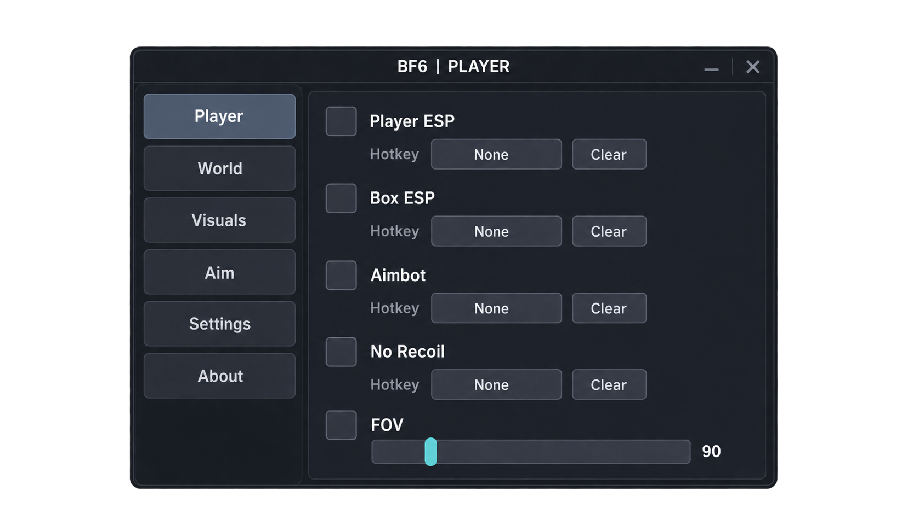

# BF6 Overlay

<strong> Battlefield 6 Soft</strong>

---

## 📚 Contents

- [About](#-about)
- [Visual sections](#-visual-sections)

---

## 🎮 About

2. Launch the launcher and click RUN
3. Wait for the launcher to update
4. Select the game and click on LAUNCH
5. In the game, open the menu on the INS button

## ✨ CHEAT FUNCTIONAL

| Section | Interface elements |
| --- | --- |
| **Player** | Player ESP, Box ESP |
| **Aim** | Aimbot, FOV |
| **Settings** | Toggles, key bindings |

Fan-made HUD interface.

