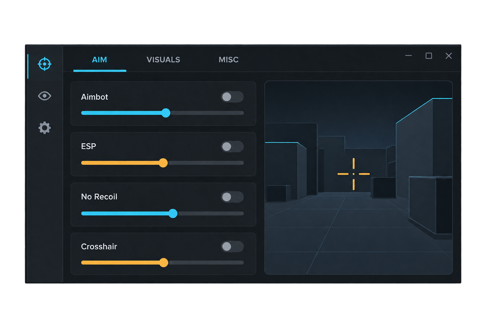

# BF6 Cheat Concept — визуальный макет

> **Ничего настоящего здесь нет.** Это шуточная концепция интерфейса: только картинка и текст, без чита, игрового кода и подключения к Battlefield 6.

  

<strong>Выглядит как панель чита. Работает как картинка.</strong>

## Что изображено

- **ESP** — декоративная карточка интерфейса; ничего не обнаруживает и не показывает в игре.
- **Aimbot** — элемент макета; наведения и помощи в стрельбе нет.
- **No Recoil** — подпись на макете; отдачу не меняет.

## Чего в проекте нет

- исполняемого файла или исходников чита;
- доступа к памяти, процессам или файлам игры;
- ESP, автоприцеливания, управления отдачей или автоматизации;
- обхода античита или инструкций по его обходу.

Это не продукт, не чит и не официальный проект EA. Репозиторий создан только для демонстрации визуальной идеи и оформления README.
